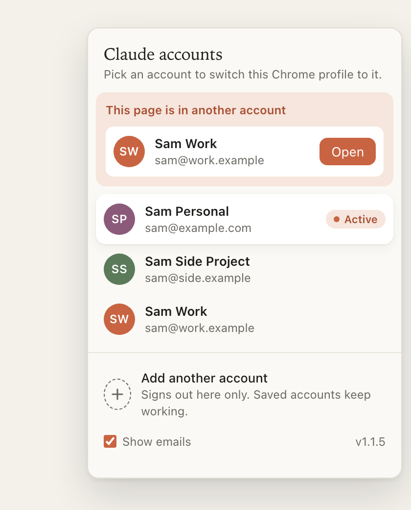
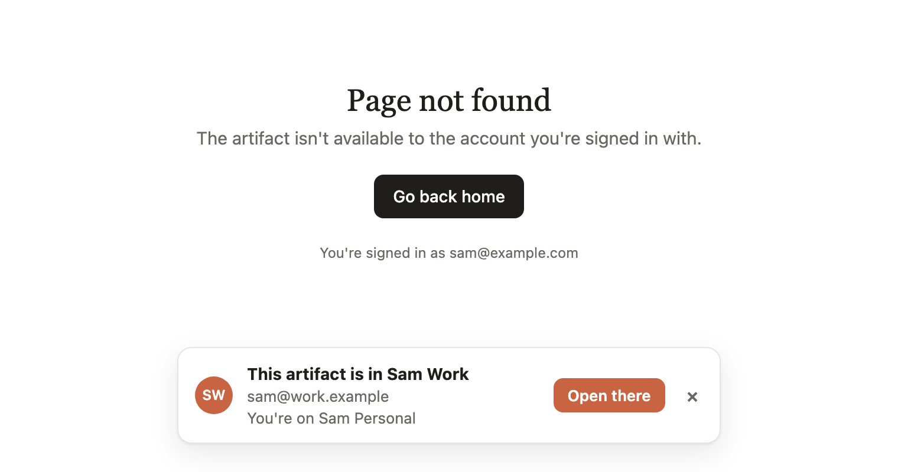

# Claude Switcher

> Switch between your claude.ai accounts in one Chrome profile, without signing in each time.

<picture>
  <source media="(prefers-color-scheme: dark)" srcset="docs/popup-dark.png">
  
</picture>

It remembers each account's claude.ai session and swaps it in when you pick that account.

## Install

1. Download this repo (**Code → Download ZIP**) and unzip it, or `git clone` it.
2. Open `chrome://extensions`, turn on **Developer mode**, click **Load unpacked** and pick the folder.
3. Pin the extension.

## Use

1. Sign in to claude.ai and open the extension. The account is saved automatically.
2. Click **Add another account**, sign in to the next account, then open the extension again.
3. From now on, click an account to switch to it. Your claude.ai tabs reload where they are.

Don't use claude.ai's **Log out** on a saved account. It ends that session on Anthropic's side and you'll have to sign in again. Use **Add another account** instead.

## Links from your other account

Open an artifact that belongs to one of your other accounts and claude.ai shows "Page not found". The extension checks your saved accounts and offers to open it in the right one.

<picture>
  <source media="(prefers-color-scheme: dark)" srcset="docs/card-dark.png">
  
</picture>

## Update

The popup shows your version and tells you when a newer one is out. Run `git pull` in the extension's folder (or download the ZIP again), then click the reload icon on the extension in `chrome://extensions`.

## Good to know

- Sessions are stored unencrypted in the extension's local storage, on your machine only. Anyone with access to your Chrome profile can use them.
- To find an artifact's account, the extension asks claude.ai with each saved account's session. That request goes only to claude.ai and doesn't change which account you're signed in as.
- Emails and the artifact check rely on claude.ai's internal API, which can change without notice. If it does, the extension stays quiet and switching still works.
- Not affiliated with Anthropic.

## License

[MIT](LICENSE)
